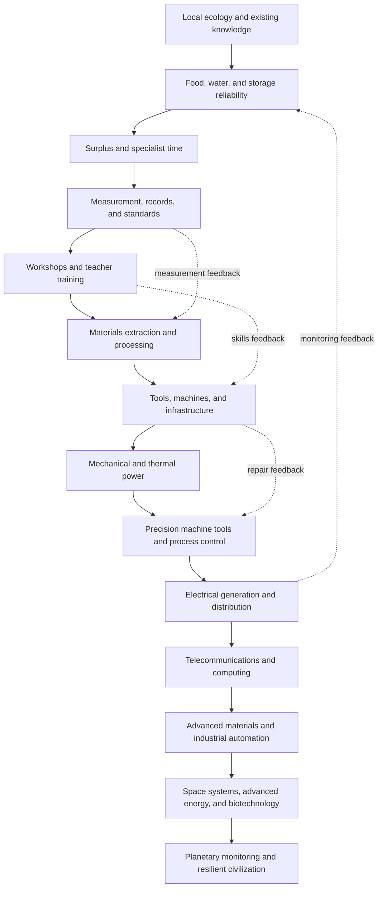

# The Prophet Project

> **“If we had 5,000 years, we could survive. We have six months. So we send someone back to buy us the time.”**


**The Prophet Project** is an evidence-led, systems-engineering playbook for accelerating a community from a low-technology starting point toward the modern technological frontier—and for making that mission survive its founder.

Its central question is:

> Starting with almost no modern technology, what knowledge, tools, infrastructure, institutions, and human capabilities must be developed—and in what dependency order—to reach the capabilities humanity has today as quickly as plausibly possible?

The project is presented through a fictional “Prophet” / time-transfer premise, but the core work is practical systems analysis: technology dependencies, learning curves, resource constraints, social legitimacy, and continuity across generations. Egypt and the Pharaoh-era setting are illustrative narrative choices, not mandatory constraints on every scenario.

This is not a catalogue of inventions or a plan to control people. It models the complete system that makes invention, adoption, and durable cooperation possible.

---

## Table of Contents

- [Project at a Glance](#project-at-a-glance)
- [The Lore](#the-lore)
- [Temporal and Historical Baseline](#temporal-and-historical-baseline)
- [The Mission](#the-mission)
- [What Success Means](#what-success-means)
- [Scope](#scope)
- [The Non-Magic Contract](#the-non-magic-contract)
- [Methodology](#methodology)
- [Evidence and Confidence Standard](#evidence-and-confidence-standard)
- [Repository Structure](#repository-structure)
- [The Master Roadmap](#the-master-roadmap)
  - [Phase 0 — Arrival and Legitimacy](#phase-0--arrival-and-legitimacy)
  - [Phase 1 — Food, Health, Measurement, and Records](#phase-1--food-health-measurement-and-records)
  - [Phase 2 — Materials, Trade, Law, and Infrastructure](#phase-2--materials-trade-law-and-infrastructure)
  - [Phase 3 — Mechanical Power, Iron, Optics, and Reproducible Knowledge](#phase-3--mechanical-power-iron-optics-and-reproducible-knowledge)
  - [Phase 4 — Industrial Chemistry, Steam, and Precision Manufacturing](#phase-4--industrial-chemistry-steam-and-precision-manufacturing)
  - [Phase 5 — Electricity, Communications, Modern Industry, and Computing](#phase-5--electricity-communications-modern-industry-and-computing)
  - [Phase 6 — Information, Space, Nuclear Energy, and Biotechnology](#phase-6--information-space-nuclear-energy-and-biotechnology)
  - [Consolidation and Threat Preparation](#consolidation-and-threat-preparation)
- [Civilizational Dependency Model](#civilizational-dependency-model)
- [Technology Capability Levels](#technology-capability-levels)
- [The Prophet's Toolkit](#the-prophets-toolkit)
- [Knowledge Base Requirements](#knowledge-base-requirements)
- [Geography, Resources, and Logistics](#geography-resources-and-logistics)
- [Manpower, Food, and Economic Feasibility](#manpower-food-and-economic-feasibility)
- [Governance and Social Legitimacy](#governance-and-social-legitimacy)
- [Teaching and Knowledge Transfer](#teaching-and-knowledge-transfer)
- [Structured Data Model](#structured-data-model)
- [Validation and Simulation Tools](#validation-and-simulation-tools)
- [Risks, Failure Modes, and Early-Warning Indicators](#risks-failure-modes-and-early-warning-indicators)
- [Repository Development and GitHub Pages](#repository-development-and-github-pages)
- [Contributing](#contributing)
- [Initial Milestones](#initial-milestones)
- [License](#license)
- [Research Starting Points](#research-starting-points)
- [Acknowledgments](#acknowledgments)

---

## Project at a Glance

| Field | Current definition |
|---|---|
| Project type | Open research and systems-engineering documentation project |
| Narrative premise | One-way consciousness transfer from 2026 CE to approximately 2975 BCE |
| Starting scenario | Configurable; Egypt c. 2975 BCE is one illustrative baseline, not a universal constraint |
| Historical baseline | Early Dynastic Period, approximately 3100–2686 BCE |
| Planning horizon | Approximately 5,000 elapsed years |
| Primary objective | Accelerate capability-building toward modern technology while preserving human wellbeing, agency, and mission continuity |
| Main method | Technology dependency models, resource accounting, workforce models, institutions, and teaching systems |
| Published output | A static website with three reader paths: Uomo Universale, Technology Roadmap, and Civilization Playbook |
| Hosting target | GitHub Pages |
| Current status | Planning; historical and engineering assumptions require review |

### What this repository is

- A map of the prerequisites behind major technologies.
- A model of the food, energy, materials, labor, and institutions that support technical work.
- A research ledger that distinguishes evidence from estimates and speculation.
- A practical framework for converting knowledge into repeatable local capability.
- A public, version-controlled reference that can be challenged, corrected, and improved.

### What this repository is not

- A claim that a single individual can personally build an industrial civilization.
- A guarantee that the proposed timeline is achievable.
- A fantasy technology tree in which an invention appears as soon as someone names it.
- A justification for conquest, slavery, coercion, or rule by an unquestionable technocrat.
- A substitute for specialist review, archaeological evidence, engineering testing, or medical evidence.

---

## The Lore

**Year: 2026 CE.**

A scientific consortium discovers an incoming extinction-level threat. Its mechanism is understood by the researchers, but the available time is catastrophically short. Every credible response model fails under the civilization's current technological and organizational constraints.

The consortium then asks a different question:

> If humanity had several additional millennia to prepare, could it build the capabilities required to survive?

In the fictional premise of this project, a large-scale simulation returns a conditional answer: **approximately 5,000 years of coordinated development would be sufficient**.

Humanity has only six months.

There is one intervention. A prototype device can transfer one human consciousness into the distant past. The transfer is one-way. The receiving body is reconstructed at the destination according to the machine's fictional operating rules. The Prophet arrives without equipment, followers, money, or an external database.

The Prophet carries a curated, generative model of human knowledge: scientific principles, engineering methods, medical knowledge, historical experience, practical procedures, and the ability to teach them. The fictional enhancement also provides exceptional memory, reasoning, health, and practical aptitude.

The destination is **approximately 2975 BCE in Egypt**, within the Early Dynastic Period. The Prophet enters a society that already has farmers, craftspeople, administrators, religious institutions, long-distance contacts, writing, metalworking, and political organization. These are not obstacles to be erased. They are the foundation on which the plan must build.

The first challenge is not to command the world. It is to become useful, survive, earn trust, and create institutions capable of carrying knowledge forward after the Prophet is gone.

The second challenge is much harder: convert isolated demonstrations into a self-correcting civilization.

The Prophet does not bring a finished industrial society. The Prophet brings a way to help people build one.

### Fictional premises versus research claims

The following are accepted only as narrative premises:

1. Consciousness can be transferred into the past.
2. A biological body can be reconstructed at the destination.
3. The Prophet can retain an extraordinary volume of knowledge and procedural skill.
4. The threat model's simulation can identify a five-millennia preparation window.

None of these is presented as established science. Everything downstream—materials, agriculture, energy, medicine, logistics, institutions, and engineering—must be evaluated against evidence and known physical constraints.

The phrase **“100% survival”** belongs to the fictional simulation, not to the project's scientific conclusions. In the research roadmap, outcomes must be expressed as conditional scenarios with uncertainty, not as absolute guarantees.

---

## Temporal and Historical Baseline

### Date convention

The story begins in 2026 CE. A transfer approximately 5,000 years backward places the Prophet around **2975 BCE**. The familiar historical notation has no year zero, so the project should use elapsed time—`Year 0`, `Year 1`, and so on—for planning calculations, while keeping BCE/CE labels for historical reference.

The exact date of the fictional extinction event should eventually be stored in `docs/lore/temporal-assumptions.md`. Until then, all phase dates are approximate planning windows.

### The baseline is configurable

The full ambition runs from a near-zero modern-technology baseline to the contemporary frontier. The Egypt c. 2975 BCE scenario is retained as one vivid, researchable example—not as a limit on the project's scope. Other starting populations, geographies, resource endowments, and time windows should be expressible as scenarios. A “fastest plausible” path must be conditional on those inputs rather than presented as a universal timetable.

### Egypt is not a Stone Age blank slate

The phrase “from the Stone Age to the Information Age” describes the full ambition of the roadmap, not the Prophet's exact starting conditions. Around 2975 BCE, Egypt was already a complex and rapidly developing society.

| Capability or condition | Evidence-based starting point | Consequence for the project |
|---|---|---|
| Political organization | The Early Dynastic state was consolidating around kingship and regional administration. | Work through existing institutions; do not assume a modern-style state or an unlimited central command. |
| Writing | Egyptian hieroglyphic writing emerged before or around the beginning of the First Dynasty; administrative inscriptions are already present. | Improve literacy, record systems, notation, and teaching instead of pretending writing must be invented from zero. |
| Copper and other metals | Copper, gold, silver, and lead were known in Predynastic Egypt; mining and procurement involved the Eastern Desert, Sinai, and trade. | Build on established extraction and craft knowledge while improving process control, safety, and scale. |
| Bronze | Some early bronze objects are known, but bronze was not yet the dominant everyday metal in Egypt. | Treat tin-bronze supply and quality as a developing capability, not as a universally available material. |
| Iron | Rare early iron objects may include meteoritic iron; systematic iron production was not an established Early Dynastic industry in Egypt. | Do not assume local iron tools, blast furnaces, or an existing iron industry. |
| Transport animals | Donkeys were already being used to carry heavy loads by the First Dynasty. | Improve routes, pack systems, fodder, veterinary care, and logistics rather than “introducing” donkeys. |
| Agriculture | Nile-based farming, animal husbandry, food storage, and organized agricultural production already existed. | Improve yields and resilience through measurement and local trials; avoid importing crop practices without ecological testing. |
| Craft specialization | Pottery, stonework, metalworking, textiles, and elite craft production were established. | Identify master craftspeople and co-design improvements with them. |

**Terminology note:** “Pharaoh” is convenient modern shorthand for an ancient Egyptian king, but the word's use as a title for the king himself is later than the Early Dynastic Period. The technical documentation will therefore use **king**, **royal court**, or the historically appropriate title where known. The lore may retain “Pharaoh” for readability, provided the anachronism is acknowledged.

**Writing-system note:** Do not introduce a fully formed alphabet in Year 1 as though Egyptian writing did not exist. The earliest alphabetic scripts developed much later through contact between Egyptian writing traditions and Semitic speakers. The near-term opportunity is to improve administrative notation, teaching materials, numeracy, and scribal efficiency while respecting the existing script and its users.

**Irrigation note:** Do not assume that every later Egyptian water-lifting device was available in 2975 BCE. The shaduf and water-wheel chronology must be researched separately. Begin with documented local basin-irrigation systems, canals, embankments, water measurement, and maintenance practices.

These corrections are not minor details. A roadmap that misunderstands its starting society will miscalculate every later labor, political, and technological dependency.

---

## The Mission

Develop a complete, evidence-led roadmap for accelerating the development of a resilient, scientifically capable civilization from the Early Dynastic Egyptian baseline toward modern industrial and information-age capabilities within an approximately 5,000-year planning horizon.

For each capability, the project must answer:

1. **Purpose:** What problem does it solve, and for whom?
2. **Prerequisites:** What knowledge, tools, materials, energy, institutions, and skills are required?
3. **Inputs:** What resources are needed, in what quantity and quality?
4. **Process:** What are the stages from raw input to usable output?
5. **People:** Which skills are required, how many person-days are needed, and how are workers trained?
6. **Location:** Where can the necessary resources be obtained, and how can they be transported?
7. **Quality:** How is the output measured, tested, repaired, and standardized?
8. **Risks:** What can fail, and what harms may result?
9. **Alternatives:** What fallback routes exist if a prerequisite is unavailable?
10. **Institutional form:** What organizations must maintain the capability after the original builders are gone?
11. **Evidence:** Which claims are documented, calculated, estimated, or speculative?

The final product is a living technical reference and static website. It should make the reasoning inspectable—not merely present a polished timeline.

---

## What Success Means

“Modern technology” is not itself a sufficient success criterion. A civilization can possess advanced weapons or impressive machines while remaining vulnerable to famine, institutional collapse, epidemic disease, or concentrated power.

The project therefore defines success across several dimensions:

### Technical capability

- Can the society independently reproduce critical tools, machines, materials, medicines, and energy systems?
- Can it maintain and repair them without relying on a single foreign supplier or specialist?
- Can it measure quality and diagnose failure?

### Human wellbeing

- Is food security stable across ordinary and bad years?
- Are safe water, sanitation, basic healthcare, and education broadly available?
- Are dangerous occupations controlled through training, protective practices, and inspection?
- Are the benefits of productivity distributed well enough to sustain social legitimacy?

### Institutional resilience

- Can public institutions survive leadership succession?
- Can corruption, fraud, and technical error be detected and corrected?
- Can communities challenge bad decisions without being treated as enemies?
- Can critical services continue during regional disruption?

### Knowledge continuity

- Are essential capabilities documented in durable, redundant forms?
- Are there enough independent teachers, technicians, and institutions to reproduce them?
- Can the society recover from the loss of a capital, archive, factory, or expert group?

### Threat readiness

- Can the society detect the relevant hazard?
- Can it coordinate a response across regions?
- Can it protect food, water, energy, health, communications, and critical manufacturing under stress?
- Can it deploy the threat-specific countermeasure identified by the fictional premise?

**Important limitation:** while the specific extinction threat remains unspecified, the project can define general resilience requirements but cannot prove that humanity will survive that particular threat. A later threat specification must define measurable environmental conditions, warning time, scale, and required response capability.

---

## The Public Website: Three Guides

The website is organized around three complementary paths. Each can be read independently, but together they form the project’s operating model.

1. **Become the Uomo Universale** — develop the broad knowledge, practical skill, judgment, physical and mental sustainability, communication, and teaching ability required of a capable mission-starter. “Prophet” is a narrative role and candidate standard, not a claim of supernatural authority.
2. **Technology Roadmap** — follow the dependencies from basic survival and measurement through agriculture, materials, energy, scientific instruments, manufacturing, electricity, computation, and the contemporary frontier. Every step should state prerequisites, outputs, bottlenecks, risks, and confidence.
3. **Civilization Playbook** — adapt to the local context, earn trust through demonstrable value, communicate the mission, forecast obstacles, build a healthy culture of shared purpose, train successors, and make the work continue without the founder.

### Continuity without coercion

The project may study how religions and other durable communities use shared narratives, calendars, symbols, ceremonies, service, and intergenerational teaching to preserve a common objective. It does **not** prescribe coercive cult formation, deception, isolation, unquestionable authority, or manipulation. A resilient mission must protect informed consent, dissent, exit, independent verification, and leadership succession. Its purpose should be legible and revisable by the people doing the work.

## Scope

### In scope

- Agriculture, domestication, soil science, irrigation, food storage, and food safety
- Animal husbandry, veterinary care, draft power, and transport systems
- Pottery, ceramics, bricks, lime, plaster, glass, and refractories
- Mining, ore beneficiation, smelting, refining, alloying, casting, forging, and material testing
- Mechanical systems: levers, pulleys, gears, cams, screws, bearings, pumps, and machine tools
- Water, wind, thermal, chemical, and electrical energy systems
- Chemistry: materials, separation, acids, bases, salts, dyes, soaps, fertilizers, and industrial process control
- Public health, hygiene, anatomy, clinical observation, surgery, pharmacology, epidemiology, and medical manufacturing
- Mathematics, measurement, statistics, numerical methods, and computation
- Optics, lenses, microscopy, telescopes, and precision instruments
- Writing, accounting, standards, archives, paper, printing, libraries, and mass education
- Navigation, cartography, ports, ships, roads, canals, railways, and aviation
- Telecommunications, power distribution, electronics, computing, and networks
- Modern agriculture, synthetic fertilizer, food processing, and resilient supply chains
- Aerospace, planetary observation, satellites, and space infrastructure
- Nuclear energy at a high-level civilian systems-engineering level, including safety and waste management
- Biotechnology, diagnostics, vaccines, fermentation, biosafety, and public-health systems
- Materials science, polymers, composites, high-purity materials, and metrology
- Economics, governance, law, diplomacy, public administration, and institutional design
- Education systems, apprenticeship, teacher training, research institutions, and knowledge preservation
- Resource mapping, logistics, manpower, risk analysis, and continuity planning

### Out of scope for the initial release

- Engineering the fictional time machine
- Proving consciousness transfer is physically possible
- Specifying the exact extinction mechanism before the story defines it
- Magic, supernatural causation, or impossible materials
- Detailed weapons construction or conquest planning
- Treating speculative technologies as guaranteed solutions
- Reconstructing every historical event or every invention in encyclopedic detail

Military history may be studied where it affects state formation, logistics, or defensive resilience. However, conquest and weapons production are not the project's default development strategy or measures of success.

---

## The Non-Magic Contract

The story may contain impossible premises. The roadmap may not.

1. **Conservation laws apply.** Energy, mass, and materials must come from somewhere.
2. **No free precision.** A design that requires tight tolerances also requires measurement, tooling, stable materials, and quality control.
3. **No instant scale-up.** A successful prototype is not an industrial supply chain.
4. **No invisible labor.** Work requires trained people, time, food, tools, supervision, and maintenance.
5. **No free logistics.** Ore at a deposit is not the same as refined metal at a workshop.
6. **No assumed social compliance.** People have goals, rights, knowledge, loyalties, and reasons to refuse.
7. **No unsafe medical shortcuts.** Medical practices require evidence, dose control, hygiene, monitoring, and ethical safeguards.
8. **No single-point-of-failure institutions.** Critical knowledge and authority must be distributed.
9. **No technological inevitability.** A capability can be delayed, abandoned, or replaced by a better route.
10. **No false certainty.** Estimates must carry uncertainty ranges and explain their assumptions.

The Prophet can accelerate discovery by supplying theory, designs, and tested principles. The Prophet cannot eliminate local experimentation, tacit skill, scarce materials, political negotiation, or production bottlenecks.

---

## Methodology

The project uses ten linked methods.

### 1. Capability dependency model

Technologies are represented as a directed **AND/OR dependency network**, not as a single linear invention list.

- An **AND dependency** means all listed prerequisites are required.
- An **OR dependency** means any one of several alternatives may satisfy a requirement.
- A **conditional dependency** applies only in a particular geography, production route, or quality level.
- A **feedback loop** represents iterative research or process improvement. Feedback loops are modelled separately from the prerequisite graph so that the dependency graph can still be checked for cycles.

Example: an early atmospheric steam pumping engine does not require modern steel. It does require a workable boiler and cylinder, pumping equipment, seals, a beam or linkage, fuel, maintenance skills, and a way to manufacture sufficiently accurate components. Higher-pressure and later engines impose additional material and safety demands.

### 2. Resource and process accounting

Each process is modelled from deposit or biological source to usable output:

`deposit → extraction → beneficiation → transport → processing → quality test → storage → end use → recycling`

The model distinguishes:

- geological occurrence
- estimated resource
- technically recoverable resource
- economically recoverable reserve
- material actually accessible to the society at a given date

Modern reserve estimates must never be copied into an ancient scenario as though ancient miners could access the same quantity or grade.

### 3. Food and energy accounting

Food surplus supports specialists. Energy surplus supports mechanization. Both must be calculated before assigning large workforces or setting industrial targets.

### 4. Labor and skill modelling

A headcount is not a workforce plan. Projects require person-days by skill, season, location, and task. Training time, worker health, tool availability, supervision, transport, and maintenance must be included.

### 5. Institutional bootstrapping

Every technical capability has an institutional owner: a workshop, school, guild, public office, research group, utility, or regulated producer. The roadmap must define who maintains standards, trains replacements, finances work, and resolves disputes.

### 6. Knowledge-transfer engineering

Knowledge must move from the Prophet's memory into repeatable procedures, curricula, standards, demonstrations, archives, and teacher-training systems.

### 7. Geography and logistics

Resource maps are paired with realistic transport routes, travel times, seasonal constraints, political access, and storage losses. A mine is useful only when a society can reach it, work it, protect it, and move its output.

### 8. Risk and resilience analysis

Every critical capability receives failure modes, warning indicators, mitigations, and at least one fallback route where a credible alternative exists.

### 9. Iterative validation

The roadmap is revised as historical or engineering evidence changes. A phase is not “complete” because a date has passed; it is complete when its exit criteria are demonstrated.

### 10. Ethical review

The project explicitly evaluates the consequences of labor systems, public-health interventions, surveillance, political centralization, environmental extraction, and technological concentration. An efficient system that predictably destroys trust or wellbeing is not a successful system.

---

## Evidence and Confidence Standard

Every important claim must be labelled:

| Label | Meaning | Example |
|---|---|---|
| `verified` | Supported by reliable primary evidence, replicated experiments, or established engineering practice. | A documented artefact, process, or physical law. |
| `calculated` | Derived from stated inputs and a transparent model. | Estimated energy demand from a stated process balance. |
| `estimated` | A reasoned estimate with meaningful uncertainty. | Expected workforce for a proposed workshop. |
| `speculative` | A hypothesis that needs research, testing, or a favourable assumption. | A proposed acceleration factor for a social institution. |

### Source hierarchy

Prefer, in roughly this order:

1. Primary archaeological reports, excavation records, artefact analyses, and original datasets.
2. Peer-reviewed research and specialist books from reputable academic publishers.
3. National museums, universities, scientific agencies, and professional engineering institutions.
4. Standards bodies and technical handbooks for modern processes.
5. Reputable secondary sources for orientation, not as the sole support for contested claims.

### Citation requirements

Each technology or resource dossier should include:

- full title and author or responsible institution
- publication date and access date where relevant
- DOI, stable URL, dataset identifier, or archive reference
- the exact claim supported by the source
- any known disagreement or limitation

A citation does not automatically make an estimate correct. Archaeological evidence, experimental archaeology, modern industrial practice, and proposed alternate-history projections must remain distinguishable.

---

## Repository Structure

The initial repository should favour a maintainable documentation system over a custom frontend built too early.

```text
prophet-project/
├── README.md
├── LICENSE
├── CONTRIBUTING.md
├── CODE_OF_CONDUCT.md
├── CITATION.cff
├── CHANGELOG.md
├── mkdocs.yml
├── requirements.txt
├── docs/
│   ├── index.md
│   ├── lore/
│   │   ├── the-prophet.md
│   │   ├── the-machine.md
│   │   ├── the-danger.md
│   │   └── temporal-assumptions.md
│   ├── methodology/
│   │   ├── dependency-model.md
│   │   ├── evidence-standard.md
│   │   ├── resource-accounting.md
│   │   ├── manpower-model.md
│   │   ├── knowledge-transfer.md
│   │   └── ethics-and-governance.md
│   ├── baseline/
│   │   ├── egypt-c2975-bce.md
│   │   ├── ancient-near-east.md
│   │   └── baseline-uncertainties.md
│   ├── phases/
│   │   ├── phase-0-arrival.md
│   │   ├── phase-1-food-health-records.md
│   │   ├── phase-2-materials-trade-law.md
│   │   ├── phase-3-mechanics-iron-print.md
│   │   ├── phase-4-chemistry-steam-machines.md
│   │   ├── phase-5-electricity-industry-computing.md
│   │   ├── phase-6-information-space-biotech.md
│   │   └── consolidation-and-threat-readiness.md
│   ├── technologies/
│   │   ├── agriculture.md
│   │   ├── water-management.md
│   │   ├── public-health.md
│   │   ├── writing-and-numeracy.md
│   │   ├── ceramics-and-glass.md
│   │   ├── metallurgy.md
│   │   ├── mechanics-and-machine-tools.md
│   │   ├── chemistry.md
│   │   ├── energy.md
│   │   ├── electricity.md
│   │   ├── communications.md
│   │   ├── computing.md
│   │   ├── aerospace.md
│   │   └── biotechnology.md
│   ├── geography/
│   │   ├── egypt-and-the-nile.md
│   │   ├── resource-atlas.md
│   │   ├── routes-and-ports.md
│   │   └── logistics.md
│   ├── institutions/
│   │   ├── governance.md
│   │   ├── law-and-contracts.md
│   │   ├── education.md
│   │   ├── workshops-and-guilds.md
│   │   ├── public-health-service.md
│   │   └── standards-and-inspection.md
│   ├── risk/
│   │   ├── failure-modes.md
│   │   ├── early-warning-indicators.md
│   │   └── contingency-plans.md
│   └── references/
│       └── bibliography.md
├── data/
│   ├── schemas/
│   │   ├── technology.schema.json
│   │   ├── resource.schema.json
│   │   ├── phase.schema.json
│   │   ├── workforce.schema.json
│   │   └── risk.schema.json
│   ├── technologies.json
│   ├── resources.json
│   ├── phases.json
│   ├── workforce.json
│   ├── trade_routes.json
│   └── risks.json
├── scripts/
│   ├── validate_data.py
│   ├── validate_dependencies.py
│   ├── calculate_workforce.py
│   ├── calculate_material_balances.py
│   └── build_site_data.py
├── tests/
│   ├── test_schemas.py
│   ├── test_dependencies.py
│   ├── test_material_balances.py
│   └── test_workforce.py
└── .github/
    ├── ISSUE_TEMPLATE/
    ├── PULL_REQUEST_TEMPLATE.md
    └── workflows/
        ├── validate.yml
        └── pages.yml
```

The generated website output (`site/`) should normally be build output and should not be edited by hand. The documentation source remains in `docs/`; structured source data remains in `data/`.

---

## The Master Roadmap

The dates below are **planning envelopes**, not historical predictions. Technologies overlap, diffuse unevenly, and may be developed earlier or later depending on local resources, institutions, and external contact. The roadmap should be managed by exit criteria and prerequisite readiness, not by blindly advancing the calendar.

| Phase | Elapsed years | Main objective | Major constraints | Exit condition |
|---|---:|---|---|---|
| 0 | 0–5 | Survival, language, legitimacy, first teaching circle | Trust, local politics, personal safety | Protected workshop/school, useful local relationships, first reproducible improvements |
| 1 | 5–100 | Food resilience, public health, measurement, records | Surplus, water, disease, teacher capacity | Stable surplus and institutions that reproduce basic knowledge |
| 2 | 100–500 | Materials, trade, law, transport, engineering institutions | Tin and other bottlenecks, logistics, political continuity | Reliable specialist production and regionally connected supply routes |
| 3 | 500–1200 | Mechanical power, iron/steel where feasible, optics, printing | Fuel, precision, skilled labour, paper/ink supply | Reproducible machines, measurement, and mass knowledge reproduction |
| 4 | 1200–2200 | Industrial chemistry, steam, machine tools, large-scale manufacturing | Coal/fuel, refractories, precision machining, industrial safety | Machine tools can reproduce key machine components; industrial processes are controlled |
| 5 | 2200–3200 | Electricity, communications, modern materials, computing precursors | Copper, insulation, high-purity materials, energy distribution | Reliable regional grids, telecommunications, advanced manufacturing, computing systems |
| 6 | 3200–4500 | Information infrastructure, space systems, advanced energy and biotechnology | Semiconductor supply chain, metrology, institutional safety | Distributed high-technology capability and global monitoring/coordination |
| Consolidation | 4500–5000 | Resilience, redundancy, and threat-specific preparation | Coordination, continuity, hazard uncertainty | Demonstrated ability to sustain essential services and deploy the required countermeasure |

### Phase 0 — Arrival and Legitimacy

**Years 0–5**

> “First, survive. Then, become useful. Then, build something that can outlive you.”

#### Objective

Avoid death, exploitation, exile, or political entanglement before the Prophet has established trusted relationships. Gain access to existing institutions through demonstrable usefulness, not by claiming supernatural authority.

#### First 72 hours — a realistic protocol

1. **Assess the immediate environment.** Find safe water, shade, shelter, food, and a route to a populated area. Avoid unnecessary travel through remote desert terrain.
2. **Stay inconspicuous without creating a dangerous deception.** Do not display unexplained claims or objects. The machine's arrival mechanics are a fictional premise; the field plan begins after arrival.
3. **Establish a low-risk first contact.** Seek a household, settlement, work group, or trading location where a stranger can request water, shelter, or work without approaching armed officials.
4. **Start language acquisition.** Learn terms for water, food, family, injury, work, trade, numbers, directions, tools, crops, and social roles. Use repeated objects and situations to map words to meanings.
5. **Observe before advising.** Learn local customs, authority structures, work rhythms, seasonal conditions, and taboos. Do not mistake unfamiliar practice for inefficiency.
6. **Demonstrate one modest skill.** Examples include careful counting, consistent measurement, a useful drawing, a simple accounting improvement, or a practical craft repair. The result must be testable by others.
7. **Avoid medical showmanship.** Do not promise cures or perform unfamiliar procedures. Clean water, clean materials, careful observation, and appropriate referral are safer first demonstrations than unsupported treatment claims.

#### First 90 days

- Build enough language competence to negotiate basic needs and learn from craftspeople.
- Identify scribes, administrators, artisans, healers, farmers, boat crews, and local leaders.
- Keep a private record of observations, vocabulary, measurements, and hypotheses.
- Find a sustainable role that provides food, shelter, and access to people who can teach local practice.
- Test proposed improvements on a small scale and compare outcomes with existing methods.
- Identify likely political patrons without making one patron the sole point of survival.

#### Years 1–5

- Earn a formal position through proven results: technical advisor, scribe, surveyor, workshop organizer, physician's assistant, or another historically plausible role.
- Establish a workshop-school under local protection.
- Train a small first cohort in measurement, records, observation, and one or two practical domains.
- Create durable records in media actually available at the time.
- Introduce improvements as optional, testable methods; retain successful local methods when they work better.
- Build relationships across more than one institution so that a change of ruler or patron does not end the project.

#### Phase 0 exit criteria

- Functional spoken communication for work and negotiation.
- A stable source of food and shelter.
- At least three independently verified improvements adopted by local users.
- A protected place to teach or work.
- A first cohort able to demonstrate and teach basic methods.
- An archive of observations and procedures copied or stored in more than one place.
- Relationships across multiple local institutions.
- No dependence on a single “miracle”, prediction, patron, or personality cult.

**Anti-patterns:** claiming to be a god, deliberately provoking a religious crisis, making unverified prophecies, attempting to seize political power, introducing disruptive weapons, or announcing a grand civilizational plan before people have a reason to trust the Prophet.

### Phase 1 — Food, Health, Measurement, and Records

**Years 5–100**

> “Surplus is not a pile of grain. It is a reliable system for producing, storing, distributing, and renewing food.”

#### Objective

Increase the reliability of food production and reduce avoidable losses while building the public-health, measurement, record-keeping, and teacher-training foundations needed for specialization.

#### Priority workstreams

**Agriculture and water**

- Map local soils, flood levels, water access, crop calendars, and field yields.
- Establish controlled trials for seed selection, planting dates, field preparation, and storage varieties.
- Improve canal, basin, embankment, and drainage maintenance where local hydrology supports it.
- Track soil fertility and nutrient removal; recycle organic matter where safe and practical.
- Reduce post-harvest loss through dry storage, ventilation, pest control, and inventory rotation.
- Treat crop rotation, legumes, fallowing, and irrigation changes as local agronomic trials—not universal recipes.

**Animal systems**

- Improve care and selective breeding of animals already present.
- Record traits such as health, temperament, milk, meat, wool, fertility, traction, and disease resistance.
- Improve fodder storage, watering, shelter, and veterinary observation.
- Plan transport loads around animal welfare, seasonal routes, and available feed.

**Public health**

- Prioritize clean water, separation of waste from water supplies, food hygiene, ventilation, and safer childbirth practices.
- Establish basic case records and systematic observation of illness patterns.
- Improve wound cleanliness and care through safe, evidence-based practice.
- Develop isolation and outbreak-response procedures with humane treatment and adequate food and water for affected people.
- Avoid claiming that a single sanitation measure prevents every disease; measure outcomes.

**Measurement and administration**

- Standardize locally useful units for length, volume, mass, time, and land measurement.
- Create calibration artefacts and procedures for checking measuring tools.
- Improve accounts for grain, seed, livestock, workdays, inventories, and transport losses.
- Introduce error checking, double-entry-like reconciliation where suitable, and independent audits.
- Teach arithmetic, geometry, estimation, and basic statistics through practical problems.

**Writing and knowledge preservation**

- Work with existing scribal systems and materials.
- Improve forms, diagrams, tables, indexes, and consistent technical vocabulary.
- Create procedure sheets and reference tables alongside narrative instruction.
- Train copyists to compare copies and detect omissions or altered figures.

**Materials and workshops**

- Improve copper procurement, smelting consistency, casting, annealing, and recycling.
- Improve ceramic kilns, pottery quality, brick production, plaster, ropes, textiles, and woodworking.
- Build simple testing procedures for tools and materials.
- Record occupational hazards and reduce harmful exposure during extraction and processing.

#### Phase 1 exit criteria

- Food production and storage are measurably more reliable than the baseline.
- The system can estimate annual food availability, storage losses, and reserves.
- Basic public-health interventions are evaluated using recorded outcomes.
- Measurement standards are used across multiple workshops or administrative units.
- Core technical instructions exist in durable copies.
- A second generation of teachers can train a third without the Prophet's direct supervision.
- Agricultural, administrative, and craft improvements do not depend on permanent emergency labour mobilisation.

### Phase 2 — Materials, Trade, Law, and Infrastructure

**Years 100–500**

> “A material is not a resource until it can be found, extracted, processed, transported, tested, and maintained.”

#### Objective

Build dependable regional supply networks, improve metal and ceramic production, establish predictable law and contracts, and develop engineering organizations that can plan infrastructure over multiple generations.

#### Priority workstreams

**Metallurgy**

- Document local ore types and metal sources through geological observation and small-scale testing.
- Improve copper smelting, refining, alloy control, casting, forging, joining, and recycling.
- Evaluate arsenical copper carefully; arsenic-bearing dust and fumes create serious occupational hazards. Do not treat it as a harmless universal substitute for tin bronze.
- Develop tin-bronze production only when tin sources, transport, quality control, and reliable trade agreements exist.
- Test alloys against specific uses: tools, cutting edges, vessels, fasteners, sculpture, and repair.
- Establish material labels, batch records, and simple mechanical tests.

**Trade and logistics**

- Map the Nile, Red Sea, Mediterranean, Levantine, and desert routes that can actually be used at the relevant date.
- Establish reliable weights, contracts, storage, port facilities, and convoy or caravan practices.
- Compare imported material with local substitutes using full delivered cost, not ore price alone.
- Secure multiple suppliers for critical materials when possible.
- Build regional workshops near resources rather than transporting every raw material to one capital.

**Construction and infrastructure**

- Improve surveying, drainage, embankments, roads, docks, warehouses, and durable public buildings.
- Require maintenance plans and inspection schedules before approving large projects.
- Compare the benefit of canals, roads, ports, bridges, and storage facilities against their food and labour costs.
- Standardize common dimensions where interchangeability is useful.

**Law and administration**

- Record contracts, obligations, inheritance, debts, injury compensation, property claims, and dispute procedures.
- Create predictable processes for resolving disagreements between officials, craftspeople, merchants, and communities.
- Separate technical inspection from the office that pays for a project where possible.
- Make public works costs and results auditable.

**Scientific institutions**

- Establish specialist workshops, archives, measurement rooms, and teaching centres.
- Encourage replication of results by independent teams.
- Reward useful improvements and accurate reporting of failure, not just impressive demonstrations.

#### Phase 2 exit criteria

- More than one region can supply essential materials or credible substitutes.
- Metalworking and ceramic production have documented quality controls.
- Infrastructure projects include maintenance and lifecycle costs.
- Contracts, weights, and measures are sufficiently standardized for long-distance trade.
- Technical schools can train artisans and supervisors at a stable rate.
- Institutions can survive a change of ruler without losing their core records and personnel.

### Phase 3 — Mechanical Power, Iron, Optics, and Reproducible Knowledge

**Years 500–1200**

> “The breakthrough is not a machine. It is the ability to build, measure, repair, and improve machines repeatedly.”

#### Objective

Expand mechanical power and precision, establish regionally appropriate iron and steel production, and make technical knowledge easier to reproduce and distribute.

#### Priority workstreams

**Iron and steel**

- Investigate iron ores and fuel availability region by region.
- Develop iron smelting and forging only where furnace materials, air supply, fuel, ore preparation, and skilled labour support it.
- Separate iron production from steel production; steel quality depends on controlled carbon content and heat treatment.
- Improve forge welding, tool geometry, hardness testing, and repair.
- Avoid claims that iron is automatically cheap or abundant: ore may be widespread, but usable metal depends on process energy, fuel, transport, and skill.

**Mechanical systems and power**

- Develop pumps, water wheels, wind machines, mills, gears, cams, cranks, bearings, and mechanical transmission.
- Use water and wind power where geography permits; retain animal and human power where it remains economical.
- Build maintenance workshops and standardized replacement components.
- Develop mechanical timekeeping and measurement instruments as precision permits.

**Optics and scientific instruments**

- Improve glass quality, grinding, polishing, mirrors, magnifiers, and measurement instruments.
- Establish controlled optical experiments before attempting complex telescopes or microscopes.
- Link instrument making to material purity, geometry, and reproducible calibration.

**Paper, printing, and publication**

- Investigate suitable fibres, pulping, sizing, inks, presses, and copying methods.
- Introduce printing when type, paper, ink, and trained operators are available.
- Standardize technical manuals and issue versioned corrections.
- Build libraries and lending systems that reach beyond court and temple elites.

**Mathematics and science**

- Teach algebra, geometry, trigonometry, statistics, mechanics, and experimental design as prerequisites arise.
- Do not artificially delay mathematics such as calculus until an arbitrary “age”; teach useful theory when notation, teachers, and practical problems support it.
- Establish public demonstrations, replication, measurement standards, and records of failed experiments.

**Medicine and biology**

- Improve observation, anatomy education, sanitation, clinical records, and infection control.
- Use microscopes and laboratory methods only when the instruments and experimental controls are reliable.
- Do not equate historical variolation or other risky practices with modern vaccination. Any human medical intervention requires ethical review, safety evidence, and monitoring.

#### Phase 3 exit criteria

- Mechanical power is used reliably in productive work in suitable regions.
- Iron and steel can be produced to specified use-cases where local conditions justify them.
- Machine components can be measured and reproduced with improving consistency.
- Scientific instruments support repeatable experiments.
- Technical publications can be copied and distributed at scale.
- Research institutions document uncertainty, replication, and safety.

### Phase 4 — Industrial Chemistry, Steam, and Precision Manufacturing

**Years 1200–2200**

> “Industrialization begins when processes, machines, and standards reproduce one another.”

#### Objective

Develop industrial process control, thermal power, machine-tool capability, and the supply chains needed for sustained large-scale manufacturing.

#### Priority workstreams

**Industrial chemistry**

- Establish analytical chemistry and process measurement before scaling production.
- Develop controlled production of alkalis, acids, salts, glass, soap, dyes, pigments, and industrial gases as materials and safety systems permit.
- Treat chemical purity, corrosion, worker exposure, waste, and water contamination as engineering constraints.
- Build safe storage, labelling, ventilation, containment, and inspection practices.

**Steam and thermal machinery**

- Start with low-pressure and atmospheric systems suited to available materials and manufacturing accuracy.
- Improve boilers, cylinders, valves, seals, pumps, condensers, and heat management.
- Develop pressure testing, safety valves, inspection, and operator training before higher-pressure systems.
- Do not make modern steel a prerequisite for the first practical steam engines. Early atmospheric engines were built using the casting and craft capabilities of their period; high-pressure systems require stronger and more reliable components.

**Machine tools and metrology**

- Develop lathes, boring machines, drills, milling and shaping processes, gauges, reference surfaces, and screw standards.
- Improve the ability to bore cylinders and manufacture repeatable fits.
- Treat machine tools as a central capability: they enable the production of more accurate machine tools and components.
- Establish calibration laboratories and maintenance schedules.

**Fuel and mining**

- Survey coal and other fuels; compare energy density, transport cost, extraction risk, and ecological impact.
- Develop coke only where the geology and process route justify it.
- Avoid assuming that coal must be the only route to industrial heat or mechanical power.
- Retain water power, charcoal, peat, biomass, and other local energy sources where appropriate, while accounting for land-use limits.

**Early electricity**

- Develop electrical measurement, batteries, magnets, generators, motors, insulation, and signalling as a parallel research path.
- Use low-energy demonstrations to establish principles before attempting large grids.
- Link electrical progress to metallurgy, wire drawing, insulation, glass, and precision workshops.

**Agriculture and public health**

- Improve plant and animal science, soil fertility measurement, food processing, cold storage where feasible, and transport infrastructure.
- Develop hospitals, laboratories, and public-health services around recorded evidence and accountable practice.

#### Phase 4 exit criteria

- Precision machine tools can manufacture and repair critical components.
- Thermal power systems operate with inspection and pressure-safety regimes.
- Chemical production is measurable, repeatable, and controlled for worker and environmental hazards.
- Mining and fuel supply chains are reliable enough to support industrial plants.
- Electrical experiments and telegraphy are ready to scale where material constraints permit.

### Phase 5 — Electricity, Communications, Modern Industry, and Computing

**Years 2200–3200**

> “A network is only as useful as its standards, maintenance, and operators.”

#### Objective

Electrify productive activity, connect distant regions, develop modern chemical and materials industries, and build reliable computing systems for administration, research, and logistics.

#### Priority workstreams

**Electricity and grids**

- Scale generators, motors, transformers, insulation, meters, protection devices, and maintenance crews.
- Develop regional grids before attempting a single fragile super-network.
- Compare alternating- and direct-current architectures using distance, load, materials, and safety requirements.
- Build dispatch, load forecasting, repair, and black-start procedures.

**Communications**

- Develop telegraphy, telephony, radio, optical systems, and later digital communication.
- Standardize addressing, protocols, timekeeping, and error detection.
- Protect communication infrastructure against physical damage, fraud, and single points of failure.

**Modern industry and chemistry**

- Develop petroleum extraction and refining where economically and environmentally justified.
- Retain alternatives: coal-derived chemicals, biomass, fermentation, and electrified process heat may be relevant depending on regional resources.
- Develop polymers, synthetic fibres, lubricants, industrial gases, and pharmaceuticals under quality systems.
- Build industrial waste treatment and emissions monitoring into plant design.

**Fertilizer and agricultural systems**

- Improve nitrogen, phosphorus, and potassium management as a balanced soil system.
- Develop synthetic nitrogen fixation only when high-pressure equipment, catalysts, hydrogen supply, and substantial energy are available.
- Evaluate energy and feedstock sources: modern ammonia production is energy-intensive and commonly relies on natural gas for hydrogen and process heat, although alternative pathways can be investigated.
- Avoid treating fertilizer as a stand-alone yield solution; soil health, water, crop varieties, pests, and distribution matter too.

**Medicine**

- Establish regulated pharmaceutical manufacturing, clinical research, diagnostics, hospital systems, and population-level surveillance.
- Develop antibiotics only with reliable fermentation, purification, dosing, testing, and resistance monitoring.
- Keep vaccination, surgery, imaging, and drug production tied to quality assurance and ethical clinical practice.

**Computing precursors**

- Develop mechanical calculators, punched-card systems, relays, analog computers, and electronic components as material and energy capability advances.
- Use computation to improve engineering, inventory, weather observation, disease surveillance, and infrastructure maintenance.

#### Phase 5 exit criteria

- Regional power systems can operate, recover, and interconnect safely.
- Long-distance communications work across multiple independent routes.
- Modern chemical and pharmaceutical production has quality-control institutions.
- Agricultural inputs and outputs are monitored as whole-system balances.
- Computing is used for reproducible scientific and administrative work.

### Phase 6 — Information, Space, Nuclear Energy, and Biotechnology

**Years 3200–4500**

> “Advanced technology is a supply chain of precision, purity, energy, and knowledge.”

#### Objective

Develop advanced information systems, global observation, high-reliability energy infrastructure, and carefully governed biotechnology and materials science.

#### Priority workstreams

**Semiconductors and computing**

- Build the foundational chain: high-purity feedstocks, refined silicon, controlled crystal growth, clean environments, precision optics, photolithography, doping, deposition, etching, packaging, and test equipment.
- Develop integrated circuits only when the broader precision-manufacturing ecosystem is mature.
- Build software engineering, operating systems, networking, data storage, cybersecurity, and long-term maintenance practices alongside hardware.
- Maintain simpler and repairable computing options for essential services.

**Communications and information integrity**

- Develop fibre optics, satellite links, resilient networks, secure protocols, and interoperable data systems.
- Protect public records and scientific archives from tampering, corruption, and accidental loss.
- Create transparent rules for privacy, access, retention, and correction of errors.

**Space systems and planetary observation**

- Develop launch, propulsion, guidance, thermal protection, tracking, communications, and mission-control capabilities as an integrated programme.
- Prioritize observation and communication missions that directly improve hazard detection and scientific capability.
- Treat orbital debris, launch failures, and long-term maintenance as design constraints.

**Nuclear energy**

- Study civilian nuclear systems at the level of energy policy, materials, radiation protection, reactor safety, fuel stewardship, waste handling, and emergency planning.
- Do not treat nuclear power as a magic shortcut around industrial prerequisites.
- Keep sensitive fuel-cycle and weapon-related detail outside the public roadmap; the project's priority is safe civilian capability and resilience.
- Treat fusion as a research possibility, not a guaranteed milestone.

**Biotechnology**

- Build molecular biology, diagnostics, fermentation, vaccine platforms, genetic analysis, and controlled biomanufacturing.
- Establish biosafety, biosecurity, ethics review, containment, traceability, and public-health oversight before scaling sensitive work.
- Preserve genetic diversity in crops and livestock and maintain seed and germplasm collections.

**Advanced materials and automation**

- Develop composites, advanced ceramics, high-performance polymers, high-purity materials, sensors, robotics, and automated manufacturing where they solve defined problems.
- Evaluate the full supply chain, repairability, environmental cost, and dependence on rare or geographically concentrated materials.

**AI and decision support**

- Use computational systems to assist modelling, research, logistics, and early-warning tasks.
- Require auditability, human accountability, testing against failure cases, and limits on autonomous control of critical infrastructure.

#### Phase 6 exit criteria

- Critical computing and communication capabilities can be maintained domestically or across redundant allied regions.
- The society can observe major planetary hazards and distribute warnings.
- Advanced energy and biotechnology are governed by robust safety institutions.
- Essential technical knowledge is preserved in offline and online forms.
- Key industries have contingency routes for major supply-chain interruptions.

### Consolidation and Threat Preparation

**Years 4500–5000**

> “The final test is not whether the civilization can build extraordinary things. It is whether it can keep people alive when extraordinary things go wrong.”

#### Objective

Convert technological maturity into preparedness for the specific extinction mechanism described by the fictional premise.

#### General resilience portfolio

- Planetary monitoring and hazard-detection networks.
- Redundant food, water, energy, medical, communications, and manufacturing systems.
- Seed banks, genetic collections, scientific archives, and offline knowledge repositories.
- Distributed machine shops and spare-parts reserves for critical infrastructure.
- Hospitals, diagnostics, vaccine capability, medical supply reserves, and public-health coordination.
- Emergency governance with clear authority, public accountability, and sunset clauses.
- Education and succession plans for every critical institution.
- Regional and international agreements for resource sharing, evacuation, scientific cooperation, and conflict de-escalation.

#### Threat-specific interface

The exact hazard remains a story variable. Once defined, it must be translated into measurable requirements:

- physical mechanism and affected systems
- probability distribution and uncertainty
- warning time
- spatial and temporal scale
- exposure thresholds
- available countermeasures
- response time and resource demand
- failure conditions
- acceptable residual risk

A generic “prepare for everything” strategy cannot guarantee survival. It can, however, make the civilization more capable of detecting, absorbing, and responding to shocks.

#### Consolidation exit criteria

- No single city, mine, factory, grid, archive, or leadership group is a catastrophic single point of failure.
- Essential services can continue under severe but specified regional disruptions.
- Knowledge can be restored from independent archives.
- The population has tested emergency procedures, not merely written them.
- The threat-specific response has been independently reviewed, simulated, and tested where possible.

---

## Civilizational Dependency Model

The following diagram is an orientation map, not the actual dependency database. Real technology paths are branched, conditional, and overlapping.



### Critical-path principle

A technology may be technically possible but still blocked by another constraint. For example:

- a generator may be understood but blocked by copper supply, insulation, bearings, or precision machining;
- a fertilizer process may be chemically understood but blocked by hydrogen, catalysts, pressure equipment, and energy;
- a semiconductor may be theoretically designed but blocked by ultrapure materials, clean manufacturing, metrology, and a vast component supply chain.

The project must therefore track **capability readiness**, not merely conceptual knowledge.

---

## Technology Capability Levels

Each technology node should be assigned a maturity level. These levels are project-specific and are intended to prevent a laboratory demonstration from being mistaken for a functioning industry.

| Level | Name | Definition |
|---|---|---|
| T0 | Principle understood | The underlying theory or empirical principle is known. |
| T1 | Demonstrated | A proof of concept works under controlled conditions. |
| T2 | Repeatable prototype | Independent teams can reproduce a working prototype. |
| T3 | Pilot process | A small production process works with measured inputs, outputs, and quality. |
| T4 | Scaled capability | Production is large enough to support multiple users or institutions. |
| T5 | Maintainable industry | The society can train staff, source inputs, repair equipment, audit quality, and reproduce critical components. |
| T6 | Resilient capability | The capability survives major supply, leadership, or regional disruptions through redundancy and substitutes. |

A phase exit criterion should normally require at least T4 or T5 for its critical capabilities, not merely T1 demonstrations.

---

## The Prophet's Toolkit

The Prophet's tools are divided into fictional internal capabilities and real-world systems that must be built after arrival.

### Internal capabilities — fictional premise

| Capability | Project interpretation |
|---|---|
| Generative knowledge | Deep recall of principles, designs, methods, historical evidence, and known failure modes. |
| Exceptional reasoning | Ability to combine knowledge, identify dependencies, and adapt to local evidence. |
| Strong memory | Reliable recall of observations, names, measurements, and procedures. |
| Physical health | Exceptional health and recovery, without assuming invulnerability. |
| Practical competence | Extensive procedural knowledge, while recognizing that local materials and practice still require adaptation. |
| Social intelligence | Ability to listen, negotiate, teach, and understand competing incentives. |
| Psychological resilience | Ability to tolerate isolation, uncertainty, failure, and long-term responsibility. |

**Important distinction:** declarative knowledge (“knowing that”) is not the same as procedural skill (“knowing how”). The fictional premise grants the Prophet unusual competence, but the roadmap must still train local specialists through repeated practice. Tacit craft knowledge cannot be transferred to an entire population by reading a manual once.

### External systems — built over time

| System | Earliest role | Why it matters |
|---|---|---|
| Language and trust | Phase 0 | Makes cooperation and teaching possible. |
| Writing and records | Already present; improve in Phases 0–1 | Externalizes memory and enables administration. |
| Measurement standards | Phases 0–1 | Makes construction, trade, experiments, and quality control comparable. |
| Scientific method | Phases 0–1 onward | Provides a repeatable way to detect error and improve practice. |
| Schools and teacher training | Phase 1 onward | Multiplies knowledge beyond one expert. |
| Law and contracts | Phase 1–2 onward | Makes cooperation more predictable and limits arbitrary power. |
| Workshops and laboratories | Phase 1–3 onward | Turn ideas into tested products and processes. |
| Archives and libraries | All phases | Preserve knowledge across generations. |
| Printing and publishing | When materials and machinery permit | Reduces the cost of reproducing technical knowledge. |
| Factories and utilities | Industrial phases | Coordinate specialized production and shared infrastructure. |
| Research universities | As institutional capacity grows | Support advanced science and technical training. |
| Digital networks | Information phase | Coordinate knowledge and operations across distance. |

---

## Knowledge Base Requirements

The Prophet's knowledge should be organized as a **generative technical curriculum**, not a random encyclopedia dump.

### Foundational sciences

- Mathematics: arithmetic, algebra, geometry, trigonometry, calculus, statistics, logic, numerical methods.
- Physics: mechanics, thermodynamics, fluid dynamics, electromagnetism, optics, acoustics, atomic and nuclear fundamentals.
- Chemistry: inorganic, organic, physical, analytical, and biochemical principles.
- Biology: cell biology, genetics, evolution, physiology, ecology, microbiology, and epidemiology.
- Earth sciences: geology, mineralogy, hydrology, climatology, soils, and resource formation.

### Applied engineering

- Agriculture and irrigation engineering.
- Mining, extractive metallurgy, and materials science.
- Mechanical engineering and machine-tool design.
- Civil, structural, and transport engineering.
- Chemical and process engineering.
- Electrical and electronic engineering.
- Computer science, software engineering, and information security.
- Medical engineering and public-health systems.
- Aerospace and energy systems at the level appropriate to the project's safety scope.

### Medicine and public health

- Anatomy, physiology, pathology, pharmacology, and clinical reasoning.
- Hygiene, water and sanitation, nutrition, midwifery, and infection prevention.
- Epidemiology, diagnostics, clinical trials, medical statistics, and pharmacovigilance.
- Surgery and emergency care only within appropriate competence, equipment, and safety constraints.
- Medical manufacturing, quality assurance, cold-chain and storage requirements where relevant.

### Social systems and humanities

- Psychology, sociology, anthropology, history, economics, political science, law, diplomacy, and education.
- Institutional design, collective action, public finance, organizational behaviour, and conflict resolution.
- Historical failures: extractive states, civil wars, institutional decay, ecological exhaustion, and knowledge loss.

### Practical crafts

- Agriculture, animal care, food preservation, cooking, and storage.
- Pottery, ceramics, brickmaking, lime work, glassmaking, and textiles.
- Carpentry, masonry, surveying, rope-making, and boatbuilding.
- Mining, smelting, casting, forging, joining, and repair.
- Workshop organization, tool maintenance, measurement, and quality inspection.

### Knowledge prioritization

When memory, teaching time, or materials are limited, prioritize:

1. Principles that generate many applications.
2. Procedures that solve immediate survival and public-health problems.
3. Measurement, standards, and error correction.
4. Processes that create tools needed by other processes.
5. Teaching methods that multiply competent people.
6. Failure analysis and fallback procedures.
7. High-complexity knowledge only when its prerequisites are near maturity.

The Prophet should not spend the first years lecturing on quantum mechanics. The first years are for surviving, understanding local conditions, improving food and health, measuring results, and building a durable teaching system.

---

## Geography, Resources, and Logistics

### Why begin in Egypt?

Egypt offers a strong starting combination:

- the Nile as a transport corridor and source of water and fertile floodplain soils;
- an emerging centralized state and administrative tradition;
- existing writing, craft specialization, and organized production;
- access to copper and other mineral resources in the Eastern Desert and Sinai;
- access to stone, clay, reeds, salt, natron, and other locally useful materials;
- connections to the Levant, Red Sea, Mediterranean, and Nubian regions.

### Why Egypt is not self-sufficient

The region does not provide an easy local route to every later industrial input. Tin, suitable fuels, timber, particular ores, rubber-producing plants, and some high-purity or rare materials may require long-distance trade, regional development, substitution, or later industrial chemistry.

### Resource bottleneck register

The table is a research index, not a claim that each resource was accessible to Egypt in 2975 BCE.

| Resource or material | Important uses | Example regions to investigate | Main modelling issue |
|---|---|---|---|
| Copper ores | Tools, alloys, wire, electrical systems | Eastern Desert, Sinai, Cyprus, later Iberia | Ore quality, mining methods, fuel, and transport |
| Tin ores | Tin bronze | Afghanistan/Hindu Kush, Cornwall and Devon, other debated Eurasian sources | Source attribution and Bronze Age route feasibility are contested |
| Iron ores | Iron and steel | Widespread deposits across Africa, Asia, and Europe | Ore availability does not guarantee workable fuel, furnaces, or skill |
| Timber | Buildings, ships, charcoal, tools | Levant, Anatolia, Europe, riverine forests | Forest regeneration, transport, and competing uses |
| Coal | Industrial heat, coke, steam, electricity | Multiple later industrial regions | Seam quality, depth, mine drainage, and transport |
| Petroleum | Fuels, lubricants, petrochemicals | Middle East, Caucasus, and other basins | Discovery, drilling, refining, environmental cost |
| Sulfur and sulfide minerals | Chemical industry | Volcanic regions and sulfide ore districts | Local geology and safe processing |
| Nitrate sources | Fertilizer and industrial chemistry | Deposits, caves, guano, managed production | Supply variability and process requirements |
| Limestone | Lime, mortar, flux, cement chemistry | Abundant in parts of Egypt and elsewhere | Fuel and process control for calcination |
| Silica/quartz | Glass and later silicon feedstock | Widespread | Purity and refining are more important than raw abundance |
| Zinc ores | Brass, galvanic cells, coatings | Multiple ore districts | Smelting difficulty and metal recovery |
| Lead ores | Alloys, weights, later shielding and industrial uses | Mediterranean and wider regions | Toxicity and contamination control |
| Phosphate | Agricultural fertilizers | Sedimentary phosphate deposits, bone and guano sources | Mining, nutrient balance, and transport |
| Potash | Fertilizer and alkali chemistry | Evaporites, brines, wood ash | Concentration and sustainable sourcing |
| Natural rubber | Elastic components and insulation | Tropical regions | Geographic access; synthetic substitutes may be preferable later |
| High-purity metals and rare elements | Electronics, magnets, catalysts, specialty alloys | Highly specific global deposits and recycling streams | Purity, separation, concentration, and geopolitical concentration |

### Resource data must record

For every mapped deposit, include:

- geographic coordinates and coordinate reference system;
- mineral or resource type;
- geological context and source citation;
- evidence for ancient or later extraction;
- estimated grade and quantity, with uncertainty;
- extraction and processing requirements;
- water, fuel, and labour requirements;
- route to the nearest plausible workshop or port;
- seasonal, political, and security constraints;
- environmental and health impacts;
- substitutes, recycling potential, and alternate sources.

Do not treat a modern national resource map as an ancient logistics map. A deposit's existence, its ancient discovery, the technology to exploit it, and the political ability to transport its output are separate facts.

### Logistics by broad era

| Era | Likely transport backbone | Constraints to model |
|---|---|---|
| Early | Human porters, pack animals, river craft | Load limits, food/fodder, seasonality, security |
| Regional trade expansion | River and coastal shipping, caravans, improved roads | Ports, navigation, contracts, storage, route control |
| Mechanized era | Canals, improved roads, railways, steamships | Fuel, bridges, track, maintenance, machine parts |
| Electrified/industrial era | Rail, powered ships, motor transport, pipelines, grids | Networks, standards, repair, energy supply |
| Information era | Global shipping, aviation, satellites, digital networks | Specialized components, cybersecurity, single-source dependencies |

---

## Manpower, Food, and Economic Feasibility

### Do not assume a standing workforce of 100,000

The early Egyptian state could organize substantial projects, but the project must not assume that a ruler in approximately 2975 BCE could permanently command 100,000 people as a ready-made industrial workforce. Population totals, mobilizable labour, seasonal obligations, and the size of royal projects are different questions. The number must be researched for each period and should remain unknown where evidence is inadequate.

The model must distinguish:

- total population;
- working-age population;
- people engaged in food production;
- specialist and craft labour;
- seasonal or temporary labour mobilisation;
- military personnel;
- administrators and teachers;
- dependants and people unable to work;
- labour lost to illness, injury, travel, and maintenance.

### Core accounting equations

A first-pass model should use transparent variables rather than fixed percentages.

**Net edible food available**

```text
net_food = gross_harvest
         - seed_reserved
         - animal_feed
         - post_harvest_losses
         - spoilage
         - required reserves
         - non-food crop allocation
```

**Population support estimate**

```text
supported_population = net_edible_food / annual_food_requirement_per_person
```

This is only a coarse ceiling. It must be adjusted for diet quality, seasonal shortages, unequal distribution, storage reliability, disease, and emergency reserves.

**Available labour**

```text
available_project_labour = total_usable_labour
                         - food_production_labour
                         - household_and_care_work
                         - administration_and_teaching
                         - maintenance_and_transport
                         - other essential work
```

**Project labour demand**

```text
project_person_days = sum(task_workers * task_duration_days)
```

A first-order lower bound on project duration is:

```text
minimum_duration_days = project_person_days / workers_reliably_assigned
```

The actual duration must also include skill bottlenecks, seasonal windows, material lead times, transport, weather, breakdowns, rework, supervision, and competing demands.

### Food surplus is not free labour

A grain reserve cannot be counted simultaneously as food security, export revenue, and rations for a large construction programme. The model must track allocations and losses explicitly.

Likewise, a person moved from farming to construction is not “free” labour. The change has an opportunity cost and may reduce future harvests unless the seasonal calendar, tools, and productivity gains support it.

### Workforce model requirements

Each project should specify:

- task and skill category;
- number of qualified workers;
- training duration and attrition;
- person-days by season;
- food and water requirements;
- tools and replacement parts;
- supervision and administration;
- transport and accommodation;
- injury and illness assumptions;
- maintenance after completion;
- opportunity cost to agriculture and other production.

Avoid universal claims such as “one farmer supports ten specialists.” Support ratios vary by crop, land, tools, climate, transport, inequality, and the definition of “specialist.” Use local estimates with ranges and sensitivity analysis.

### Ethical labour principles

The roadmap must not assume slavery or coerced mass labour as a normal engineering input. It should model compensation, seasonal scheduling, worker safety, legal protections, participation, and grievance procedures. Historical systems of compulsory labour can be studied accurately, but their existence does not make them the project's preferred design.

---

## Governance and Social Legitimacy

The original narrative imagines winning the king's trust and using royal command to mobilize a vast population. Royal patronage may provide access, resources, and protection, but **world domination is not the project's preferred strategy**.

Conquest creates recurring costs: resistance, garrisons, succession conflicts, extraction pressure, damaged trade, and incentives to weaponize technical knowledge. An empire can expand faster than it can govern.

A more resilient route is to build a network of institutions and mutually beneficial relationships:

- demonstrate value through public goods;
- work with existing religious, administrative, and craft institutions;
- make standards and technical education portable across regions;
- establish predictable contracts and dispute resolution;
- allow local communities to adopt, adapt, or reject technologies;
- distribute technical knowledge and leadership;
- establish checks against corruption and arbitrary authority;
- use diplomacy, trade, and voluntary agreements before coercion.

### Institutional structure — evolving, not fixed

| Institution | Initial responsibility | Long-term evolution |
|---|---|---|
| Royal or civic patronage | Protection, legitimacy, initial resources | Public finance under clearer legal constraints |
| Council of specialists | Technical advice and review | Independent professional and scientific bodies |
| Scribes and record keepers | Accounts, inventories, correspondence | Public administration, statistics, archives |
| Workshops and guilds | Production, apprenticeship, repair | Standards-based industries and technical colleges |
| Medical practitioners | Care and observation | Regulated health services and research institutions |
| Teachers and schools | Basic literacy and practical knowledge | Mass education, universities, lifelong learning |
| Inspectors and auditors | Weights, measures, quality, fraud detection | Standards agencies, courts, professional regulators |
| Regional councils | Local coordination | Federated or treaty-based interregional governance |

No institution should be designed around the assumption that the Prophet is always present or always correct.

---

## Teaching and Knowledge Transfer

The Prophet's most important multiplier is the ability to create competent teachers.

### A cascading teaching system

A possible starting pattern is:

1. **First Circle:** a small group receiving deep training in reasoning, measurement, teaching, and selected technical fields.
2. **Second Circle:** specialists trained by the First Circle, with practical examinations and supervised work.
3. **Third Circle:** instructors, workshop leaders, administrators, and assessors.
4. **Local schools and apprenticeships:** people trained close to where they live and work.
5. **Public instruction:** basic literacy, numeracy, hygiene, measurement, and civic knowledge.

The numbers 10, 100, or 1,000 are not magic multipliers. Each expansion stage must account for teacher availability, student selection, instructional materials, practical equipment, and assessment quality.

### Teaching methods

| Method | Best use | Main limitation |
|---|---|---|
| Demonstration | Introducing a practical process | Cannot by itself transfer all tacit skill |
| Apprenticeship | Crafts, maintenance, clinical practice | Slow and dependent on competent masters |
| Oral instruction | Principles, stories, local adaptation | Memory drift and inconsistent terminology |
| Written procedures | Recipes, standards, checklists | Requires literacy and version control |
| Schools | Foundational literacy and numeracy | Needs trained teachers and sustained funding |
| Teacher-training colleges | Multiplying instructional capacity | Requires assessment and quality assurance |
| Workshops and laboratories | Practical and experimental learning | Requires tools, materials, and safe facilities |
| Printing | Standardized materials at scale | Requires paper, ink, presses, distribution, and readers |
| Digital networks | Broad access and collaboration | Requires electricity, devices, maintenance, and governance |

### Curriculum design

**Foundation:** language, literacy, numeracy, hygiene, food safety, measurement, observation, and record-keeping.

**Craft:** agriculture, animal care, pottery, textiles, carpentry, masonry, metalworking, maintenance, and logistics.

**Technical:** mathematics, mechanics, materials, chemistry, biology, engineering, surveying, and experimental methods.

**Advanced:** research methods, statistics, economics, law, institutional design, computing, and specialist sciences.

### Knowledge-preservation rules

- Keep multiple copies in geographically separate locations.
- Store important procedures in more than one medium when possible.
- Maintain master copies and controlled revisions.
- Use tables, worked examples, diagrams, and test questions to detect copying errors.
- Preserve a small, robust “survival curriculum” separately from specialist archives.
- Train successors for every critical teaching and institutional role.
- Make it possible for independent teams to reproduce important results.

The Prophet should progress through three roles: **demonstrator → teacher of teachers → institutional architect**. Remaining the sole authority is a failure condition.

---

## Structured Data Model

The repository should treat the roadmap as both documentation and structured data. Prose explains the reasoning; machine-readable records make dependencies and assumptions testable.

### Core datasets

| File | Purpose |
|---|---|
| `technologies.json` | Capabilities, dependencies, inputs, outputs, maturity, and failure modes |
| `resources.json` | Deposits, materials, access, processing, routes, and substitutes |
| `phases.json` | Planning windows, exit criteria, and milestone relationships |
| `workforce.json` | Skill categories, training, person-days, and labour assumptions |
| `trade_routes.json` | Routes, transport modes, seasonality, and political access |
| `risks.json` | Hazards, likelihood assumptions, consequences, indicators, and mitigations |

### Example technology record

```json
{
  "id": "tech_atmospheric_steam_pump",
  "name": "Atmospheric Steam Pumping Engine",
  "phase_window": [4, 4],
  "capability_level": "T2",
  "prerequisites_all": [
    "tech_reliable_boiler",
    "tech_metal_cylinder_casting",
    "tech_cylinder_boring",
    "tech_piston_seal",
    "tech_beam_pump_mechanism",
    "cap_basic_thermodynamics"
  ],
  "prerequisites_any": [
    ["resource_coal_access", "resource_charcoal_access"]
  ],
  "inputs": [
    {"id": "material_iron_or_bronze_components", "quantity": null, "unit": null},
    {"id": "resource_water", "quantity": null, "unit": null},
    {"id": "resource_fuel", "quantity": null, "unit": null},
    {"id": "labour_skilled_foundry_and_mechanical", "quantity": null, "unit": "person_days"}
  ],
  "outputs": [
    "capability_mine_dewatering",
    "artifact_pumping_engine"
  ],
  "process_summary": "Low-pressure steam is condensed in a cylinder to create a partial vacuum; atmospheric pressure drives the piston and operates a pump.",
  "quality_tests": [
    "leak_rate",
    "pump_output_per_fuel_input",
    "boiler_integrity",
    "operating_reliability"
  ],
  "failure_modes": [
    "boiler_or_pipe_failure",
    "poor cylinder fit",
    "seal leakage",
    "fuel interruption",
    "insufficient maintenance capacity"
  ],
  "fallbacks": [
    "water-powered pumps where geography permits",
    "animal-powered lifting devices",
    "manual drainage for small sites"
  ],
  "confidence": "verified",
  "sources": [
    "https://collection.sciencemuseumgroup.org.uk/objects/co50900/newcomen-atmospheric-engine-atmospheric-steam-engine"
  ],
  "notes": "This is an early atmospheric engine model, not a high-pressure steam system. Exact production requirements must be researched and quantified before simulation."
}
```

### Example resource record

```json
{
  "id": "resource_tin_cassiterite_cornwall",
  "name": "Cassiterite-bearing alluvial deposits, Cornwall and Devon",
  "category": "metal_ore",
  "material": "tin",
  "coordinates": null,
  "geological_context": "Granite-related tin mineralization and associated alluvial deposits",
  "historical_access": {
    "earliest_evidence": "Requires source-specific archaeological dating",
    "periods_of_use": [],
    "confidence": "estimated"
  },
  "processing_chain": [
    "prospecting",
    "alluvial_extraction",
    "washing_and_concentration",
    "smelting",
    "assay_and_quality_control"
  ],
  "transport_constraints": [
    "distance_to_port",
    "coastal_navigation",
    "intermediary_trade_networks",
    "seasonality_and_security"
  ],
  "substitutes": [
    "arsenical_copper_for_some_uses",
    "recycled_bronze",
    "iron_where_the_process_is_mature"
  ],
  "environmental_and_health_risks": [
    "landscape_disturbance",
    "tailings_and_sediment",
    "occupational_exposure"
  ],
  "confidence": "estimated",
  "sources": [
    "https://www.cambridge.org/core/journals/antiquity/article/from-lands-end-to-the-levant-did-britains-tin-sources-transform-the-bronze-age-in-europe-and-the-mediterranean/2330F3B6498B210DA61B89026A1F38EA"
  ]
}
```

The example uses `null` for quantities and coordinates because they should not be invented. The actual dataset must populate them only when a source or explicit calculation supports the value.

### Data validation rules

Automated checks should verify:

- IDs are unique and stable.
- All referenced technologies, resources, skills, and institutions exist.
- AND/OR prerequisites are syntactically valid.
- The prerequisite graph has no accidental cycles.
- Every technology has inputs, outputs, a maturity level, and a confidence label.
- Every critical technology has documented failure modes.
- Critical resources have substitutes, recycling routes, or an explicit unresolved-risk flag.
- Units are explicit and consistent.
- Estimates include their assumptions and uncertainty range.
- Phase windows do not contradict prerequisite maturity.
- Sources are present for historical and scientific claims.

---

## Validation and Simulation Tools

The website should eventually provide interactive tools, but deterministic validation comes first.

### 1. Dependency explorer

- Browse upstream prerequisites and downstream dependents.
- Highlight critical paths and single points of failure.
- Show alternative routes and unresolved prerequisites.
- Distinguish conceptual knowledge from maintainable industrial capability.

### 2. Resource atlas

- Map deposits and historical extraction sites.
- Filter by material, era, confidence, and accessibility.
- Display transport routes, ports, and geographic bottlenecks.
- Separate current geological knowledge from ancient accessibility.

### 3. Workforce and food model

- Model harvest ranges, reserves, losses, diet, and seasonal labour.
- Estimate project person-days by skill category.
- Show the opportunity cost of moving workers between agriculture and construction.
- Run sensitivity analyses for flood failure, drought, disease, conflict, and transport disruption.

### 4. Timeline and maturity explorer

- Display overlapping development paths.
- Show when prerequisite capabilities reach T1–T6.
- Compare optimistic, baseline, and adverse scenarios.
- Avoid representing uncertain dates as precise historical predictions.

### 5. Data quality dashboard

- Missing citations.
- Orphaned dependency nodes.
- Invalid units.
- Unquantified assumptions.
- Missing failure modes or fallbacks.
- Contradictions between data and documentation.

### Suggested implementation approach

Start with a static documentation site and validated JSON. Add custom visualizations only when the underlying data is stable.

Potential tools:

- MkDocs for documentation and GitHub Pages publishing.
- JSON Schema for data validation.
- Python for calculations, graph validation, and repeatable analysis.
- Mermaid for simple diagrams.
- Cytoscape.js or D3.js for larger interactive dependency graphs.
- Leaflet or MapLibre for resource maps, once the geographic dataset is properly sourced.

A local AI assistant may help contributors search, summarize, and draft candidate records. AI output must be treated as unverified until a human reviewer checks sources, calculations, and units.

---

## Risks, Failure Modes, and Early-Warning Indicators

| Risk | Potential impact | Early-warning indicator | Mitigation direction |
|---|---|---|---|
| Prophet dies or is incapacitated | Loss of initial knowledge and political access | Critical work depends on one person | Train successors early; duplicate records; delegate authority |
| Prophet is not believed | No access to institutions | Demonstrations are dismissed or perceived as threats | Start with modest, testable improvements; listen and adapt |
| Court factionalism | Loss of patronage or personal safety | Repeated changes in sponsors and project leadership | Build relationships across institutions; avoid a single patron dependency |
| Coercive labour or extraction | Resistance, injury, revolt, and institutional failure | Absenteeism, unrest, declining harvests, worker harm | Use transparent compensation, safety rules, participation, and audits |
| Famine or flood failure | Population loss and collapse of specialist support | Falling reserves, crop concentration, repeated shortfalls | Diversify food systems, maintain reserves, monitor water, plan contingencies |
| Epidemic disease | Loss of skilled workers and public trust | Clustered illness, rising mortality, unexplained absenteeism | Water/sanitation, surveillance, isolation with care, medical research |
| Resource bottleneck | Stalled critical path | Single supplier, falling ore grade, transport interruption | Substitute materials, recycling, multiple routes, stockpiles |
| Deforestation or soil degradation | Long-term fall in productive capacity | Falling yields, erosion, fuel scarcity | Resource accounting, replanting, soil and water management |
| Knowledge corruption | Unsafe or ineffective processes | Conflicting copies, unexplained changes in measurements | Controlled versions, independent copies, replication, audits |
| War or invasion | Loss of people, infrastructure, and trade | Mobilization growth, border instability, route insecurity | Diplomacy, resilient logistics, defensive readiness, decentralization |
| Elite capture | Benefits concentrated; innovation suppressed | Restricted education, monopoly control, opaque decisions | Open technical standards, public oversight, broad education |
| Industrial accident | Mass injury and loss of trust | Near misses, undocumented maintenance, bypassed inspection | Safety engineering, training, inspection, incident reporting |
| Over-centralization | Collapse after leadership succession | Decisions bottleneck at one office or person | Distributed institutions, legal succession, local capability |
| Technology outpaces governance | Systemic harm or destabilization | No safety review or accountability for new systems | Stage gates, independent review, public-interest rules |
| Unknown threat differs from assumed model | Preparedness fails at the final stage | Hazard assumptions remain untested | Define threat interface; maintain scenario diversity and rapid response capacity |

### Risk review cadence

Each phase dossier should include a risk register updated when:

- a major technology is scaled;
- a new resource source or trade route is adopted;
- an epidemic, famine, or conflict changes the baseline;
- a major institution changes ownership or leadership;
- a process creates new environmental or occupational hazards;
- a model assumption is contradicted by new evidence.

---

## Repository Development and GitHub Pages

### Recommended first implementation

Use MkDocs as the initial static documentation system. It keeps the project focused on research content while still producing a searchable website. Custom dashboards can be added later without moving the source of truth out of Markdown and JSON.

### Local development

```bash
# Clone your repository
 git clone https://github.com/your-username/prophet-project.git
 cd prophet-project

# Create and activate a Python environment
 python -m venv .venv

# Linux/macOS
 source .venv/bin/activate

# Windows PowerShell
 .venv\Scripts\Activate.ps1

# Install documentation and validation dependencies
 pip install -r requirements.txt

# Start the local documentation server
 mkdocs serve
```

Open the local address printed by MkDocs in your browser.

### Suggested requirements.txt

```text
mkdocs
mkdocs-material
jsonschema
networkx
pytest
```

Pin tested versions before publishing a stable release. Do not use unbounded dependency upgrades in a reproducibility-critical build without CI checks.

### Suggested validation commands

```bash
python scripts/validate_data.py
python scripts/validate_dependencies.py
pytest
mkdocs build --strict
```

### GitHub Pages deployment

GitHub Pages supports deployment through a GitHub Actions workflow that builds the static site, uploads the Pages artifact, and deploys it. Follow the current GitHub Pages documentation when creating the workflow, because action versions and repository settings can change:

- [GitHub Pages: configure a publishing source](https://docs.github.com/en/pages/getting-started-with-github-pages/configuring-a-publishing-source)

The default branch should be the only branch permitted to deploy the production website. Pull requests should run validation and a site build without publishing.

---

## Contributing

This project is interdisciplinary. Contributions are welcome from:

- archaeologists and historians;
- geologists and resource specialists;
- physicists, chemists, and biologists;
- engineers and manufacturing specialists;
- medical and public-health researchers;
- economists, logisticians, and operations researchers;
- educators and curriculum designers;
- political scientists, legal scholars, and institutional researchers;
- cartographers, GIS specialists, data scientists, and developers.

### Contribution standards

A contribution should be:

- sourced;
- explicit about uncertainty;
- consistent with known physics and chemistry;
- geographically and historically grounded;
- clear about prerequisites and outputs;
- honest about labour, energy, material, and maintenance costs;
- reviewed for safety, public health, and social consequences.

Avoid statements such as “then they invent electricity” or “the king assigns 100,000 workers.” Explain the steps, dependencies, inputs, risks, and evidence.

### Suggested issue labels

- `historical-baseline`
- `technology-node`
- `resource-data`
- `dependency-review`
- `workforce-model`
- `agriculture-and-food`
- `public-health`
- `engineering-review`
- `geography-and-logistics`
- `governance-and-education`
- `risk-analysis`
- `website-and-tooling`
- `citation-needed`

### Pull request checklist

- [ ] The change has a clear purpose.
- [ ] Historical and scientific claims have sources.
- [ ] Estimates include units and assumptions.
- [ ] Dependencies and alternatives are explicit.
- [ ] Failure modes and safety issues are considered.
- [ ] Structured data validates.
- [ ] Documentation and data agree.
- [ ] No unsupported certainty has been introduced.

---

## Initial Milestones

### v0.1 — Research foundation

- [ ] Confirm the temporal convention and destination date.
- [ ] Publish the Early Dynastic Egyptian baseline dossier.
- [ ] Define the technology, resource, phase, workforce, and risk schemas.
- [ ] Define the evidence and confidence policy.
- [ ] Create a small, reviewed dependency graph for food, water, writing, copper, ceramics, and transport.
- [ ] Add data validation and cycle detection.
- [ ] Publish the documentation site.

### v0.2 — First operational model

- [ ] Complete Phase 0 and Phase 1 dossiers.
- [ ] Add food-surplus and seasonal-labour calculations.
- [ ] Add first resource records for the Nile Valley, Eastern Desert, and Sinai.
- [ ] Add technology maturity levels and phase exit criteria.
- [ ] Add a failure-mode register and independent review process.

### v0.3 — Regional systems

- [ ] Map trade routes and material sources across the Eastern Mediterranean and Near East.
- [ ] Add copper, tin, timber, stone, salt, and fuel supply chains.
- [ ] Model workshop capacity, teacher production, and maintenance requirements.
- [ ] Compare centralized and federated institutional scenarios.

### v1.0 — Integrated roadmap

- [ ] Publish reviewed dossiers for all major technology domains.
- [ ] Validate the major dependency network.
- [ ] Run baseline, optimistic, and adverse scenarios.
- [ ] Publish interactive dependency and resource views.
- [ ] Publish a documented limitations and unresolved-questions register.

### Definition of done for any milestone

A milestone is complete when its documentation, data, tests, citations, and assumptions agree. A visually complete website is not a substitute for a validated model.

---

## License

This project is intended to use the MIT License for original source code and, if desired, original project text. See `LICENSE` for the exact terms.

**Important:** third-party datasets, photographs, maps, quotations, research figures, and code retain their own licences and attribution requirements. Do not assume the MIT License covers material copied from external sources. Consider a separate data licence and documentation licence once the repository contains substantial third-party or community-contributed datasets.

---

## Research Starting Points

These references support several historical corrections and provide entry points for deeper research. They are not a complete bibliography, and each technical dossier should add specialist sources of its own.

### Early Dynastic Egypt, writing, and administration

- [UCL Digital Egypt — Early Dynastic Egypt](https://www.ucl.ac.uk/museums-static/digitalegypt/archaicegypt/info.html) — overview of the Early Dynastic period, writing, and administration.
- [Oxford Research Encyclopedia — Origins of Writing in Northeastern Africa](https://academic.oup.com/edited-volume/61663/chapter-abstract/553461749) — discusses the early development of Egyptian writing and the later emergence of alphabetic scripts through Egyptian–Semitic contact.
- [Oxford University Press — The Origins and Early Development of Writing in Egypt](https://academic.oup.com/edited-volume/43506/chapter/364131674) — discusses the transition from early notation to formal writing and administrative use.
- [Australian Museum — Ancient Egyptian Timeline](https://australian.museum/learn/cultures/international-collection/ancient-egyptian/ancient-egyptian-timeline/) — period overview and chronology.

### Egyptian materials and transport

- [UCLA Encyclopedia of Egyptology — Copper-based Metallurgy (up to 332 BCE)](https://doi.org/10.5070/G9.4307) — research overview of Egyptian copper metallurgy and procurement.
- [UCL Digital Egypt — Metal in Egypt](https://www.ucl.ac.uk/museums-static/digitalegypt/metal/metalinegypt.html) — overview of copper, bronze, iron, and other metals in Egypt.
- [Springer — Metallurgy in Egypt](https://doi.org/10.1007/978-94-007-3934-5_9274-2) — summary of metal use and source regions, including the limited role of iron in Egypt.
- [PNAS — Domestication of the donkey: Timing, processes, and indicators](https://doi.org/10.1073/pnas.0709692105) — evidence for donkey use in early Egyptian state logistics.

### Bronze Age tin networks

- [Muhly, “Sources of Tin and the Beginnings of Bronze Metallurgy,” American Journal of Archaeology (1985)](https://doi.org/10.2307/504330) — review of possible tin sources in Europe and Western Asia.
- [Antiquity — From Land's End to the Levant: did Britain's tin sources transform the Bronze Age?](https://www.cambridge.org/core/journals/antiquity/article/from-lands-end-to-the-levant-did-britains-tin-sources-transform-the-bronze-age-in-europe-and-the-mediterranean/2330F3B6498B210DA61B89026A1F38EA) — discusses evidence for tin extraction and long-distance circulation; the exact scale and routes remain research questions.

### Industrial technology and modern processes

- [Science Museum Group — Newcomen atmospheric steam engine](https://collection.sciencemuseumgroup.org.uk/objects/co50900/newcomen-atmospheric-engine-atmospheric-steam-engine) — explains the atmospheric engine and its operating principle.
- [National Museums Scotland — The Newcomen engine and its role in Britain's Industrial Revolution](https://www.nms.ac.uk/discover-catalogue/the-newcomen-engine-and-its-role-in-britains-industrial-revolution) — describes its use in mine drainage and industrial development.
- [European Commission — History and production of fertilisers](https://agriculture.ec.europa.eu/system/files/2019-07/market-brief-fertilisers_june2019_en_0.pdf) — overview of Haber–Bosch ammonia production and its energy/feedstock requirements.
- [GitHub Docs — Configuring a publishing source for GitHub Pages](https://docs.github.com/en/pages/getting-started-with-github-pages/configuring-a-publishing-source) — current deployment workflow guidance.

---

## Acknowledgments

- **Dr. Stone** — for inspiring the central question of how knowledge can accelerate civilization-building.
- Archaeologists, historians, and experimental researchers who reconstruct technologies from fragmentary evidence.
- Farmers, craftspeople, engineers, physicians, teachers, and organizers whose work makes complex societies possible.
- Every contributor willing to replace an attractive assumption with a better-supported explanation.

> “The Prophet did not bring miracles. The Prophet brought knowledge—and the discipline to test it.”

**The goal is not to make the past obey the future. The goal is to help people in the past build a better future with the tools and choices genuinely available to them.**

[Back to top](#the-prophet-project)
